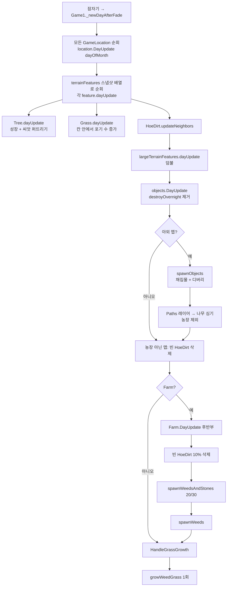
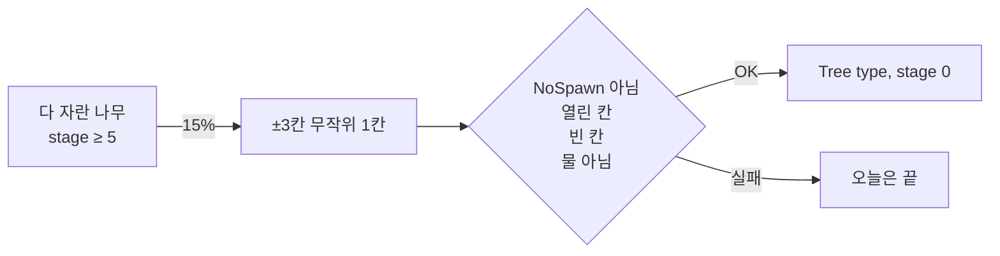

# 하루 넘김 시 자연 확산 로직 (Stardew Valley 참고)

출처: https://github.com/WeDias/StardewValley (1.5 디컴파일본)
주요 파일: `Game1.cs`, `Locations/2GameLocation.cs`, `Locations/Farm.cs`, `TerrainFeatures/Tree.cs`, `TerrainFeatures/Grass.cs`

## 0. 저장 구조 전제

| 컨테이너 | 키 | 담기는 것 |
|---|---|---|
| `terrainFeatures` | 타일 좌표 `Vector2` | `Tree`, `Grass`, `HoeDirt`, `Flooring`, `FruitTree` |
| `objects` | 타일 좌표 `Vector2` | 잡초·돌·나뭇가지(디버리), 채집물, 작물이 아닌 놓은 물건 |

한 칸에 terrainFeature 하나, object 하나씩만 들어간다. 확산 로직은 모두 "빈 칸인가?"를 이 두 딕셔너리와 타일 속성으로 판정한다.

자주 쓰는 타일 속성 (`Back` 레이어):

- `Diggable`: 흙 땅. 풀·나무가 퍼질 수 있는 바닥
- `NoSpawn`: `All` / `True` / `Tree` / `Grass` 값으로 확산을 막음
- `Water`: 물 칸 제외
- `Spawnable`: 채집물 스폰 가능 칸

## 1. 호출 순서



포인트: **각 오브젝트가 스스로 퍼지는 것(Tree)** 과 **맵이 한꺼번에 퍼뜨리는 것(Grass, 잡초·돌)** 두 갈래다.
`terrainFeatures`는 순회 전에 `ToArray()`로 스냅샷을 떠 두므로, 오늘 새로 생긴 나무·풀은 오늘 다시 퍼지지 않는다.

## 2. 나무 씨앗 확산 — `Tree.dayUpdate` (Tree.cs:374)

나무가 자기 차례에 직접 처리한다.

1. **성장**
   - 겨울이면 멈춤 (야자수 6·9, 비료, 온실류 맵은 예외)
   - `NoSpawn` 이 `All`/`Tree`/`True`면 성장도 없음
   - 단계 4 → 5(다 자람)로 넘어갈 때, 주변 3x3(192px 사각형) 안에 **다 자란 다른 나무가 있으면 막힘**. 밀도 제한 역할
   - 단계 0인데 같은 칸에 object가 올라가 있으면 막힘
   - 하루 20% 확률로 단계 +1 (마호가니 15%, 비료 주면 확정)
2. **씨앗 퍼뜨리기** (농장 맵에서만)
   - 조건: `growthStage >= 5` 이고 15% 확률
   - 위치: 자기 칸 기준 **x, y 각각 −3 ~ +3** 무작위 한 칸 (7x7 범위)
   - 그 칸이 `NoSpawn` 아님, `isTileLocationOpen`(Buildings/Front/물 아님), 비어 있음, 맵 안이면
   - → 같은 종류의 `Tree(type, 0)` 를 단계 0(씨앗)으로 추가
3. **흔들면 떨어지는 씨앗**: 매일 `hasSeed` 를 5% 확률로 다시 뽑음 (야자수 15%). 확산과는 별개로 플레이어 수확용



## 3. 풀 확산 — `HandleGrassGrowth` → `growWeedGrass` (2GameLocation.cs:943, 2639)

### 3-1. 풀 한 칸의 성장 — `Grass.dayUpdate`

- 풀 한 칸은 `numberOfWeeds` 0~4 (한 칸에 포기가 몇 개 그려지는지)
- 일반 풀(type 1)은 겨울이 아니면 매일 +1~3, 최대 4

### 3-2. 옆 칸으로 번지기 — `growWeedGrass(iterations)`

농장이거나 맵 속성 `EnableGrassSpread` 가 있고, 겨울이 아닐 때 **하루 1회** 실행한다.

```
for 모든 Grass 칸 (뒤에서부터):
	65% 확률로 이 칸 처리
	if 포기 < 4:   포기 += 0~2 (최대 4)        ← 아직 덜 찬 칸은 안 퍼짐
	else (가득 참): 상하좌우 4방향 각각
		빈 칸 && Buildings 없음 && 물 아님 && Diggable && NoSpawn 아님
		&& 25% → 같은 grassType 으로 Grass(포기 1~2) 추가
```

- **가득 찬 칸(4포기)만 번진다.** 새로 생긴 칸은 1~2포기라 며칠 자라야 다시 번짐 → 자연스러운 속도 조절
- 대각선은 없음. 4방향만
- 순회 중에 추가된 칸도 같은 루프에서 처리될 수 있지만, 포기 1~2라서 바로 번지지는 않음

### 3-3. 월초·연초 이벤트

| 시점 | 대상 | 동작 |
|---|---|---|
| 매월 1일 | 농장 / `ClearEmptyDirtOnNewMonth` | 작물 없는 HoeDirt 80% 삭제 |
| 매월 1일 | 농장 / `SpawnDebrisOnNewMonth` | `spawnWeedsAndStones(20, 새 위치)` |
| 봄 1일 (2년차부터) | 농장 / `SpawnDebrisOnNewYear` | 디버리 40 + 잡초만 40 |
| 봄 1일 | 농장 / `SpawnRandomGrassOnNewYear` | 무작위 15칸에 4포기 풀 → `growWeedGrass(40)` 으로 한 번에 크게 번짐 |
| 봄 1일 | `SpawnGrassFromPathsOnNewYear` | Paths 레이어 인덱스 22 칸에 풀 |

## 4. 잡초·돌·나뭇가지 확산 — `spawnWeedsAndStones` (2GameLocation.cs:10682)

`objects` 에 들어가는 디버리. 농장은 매일, 다른 야외 맵은 `spawnObjects` 안에서 호출된다.

### 개수

```
기본 = 95% 확률로 (25%면 10~20, 아니면 5~10), 5%는 0
비 오면 ×2, 1일이면 ×5, 농장 아니면 ÷2
농장 매일 호출은 봄·가을 20, 여름 30 고정
겨울·해변·사막은 아예 안 함
```

### 두 가지 모드

| `spawnFromOldWeeds` | 위치 결정 | 의미 |
|---|---|---|
| `true` (기본) | 기존 object 하나를 무작위로 골라 **주변 8칸 중 한 칸** | 이미 있는 잡초·돌 옆으로 번짐 |
| `false` | 맵 전체 무작위 | 새로 씨 뿌리기 (월초·연초) |

### 칸 조건

- 농장은 `Diggable` 칸에만, 다른 맵은 `Diggable` 이 **아닌** 칸에만 (마을 길바닥 등)
- `NoSpawn` 아님, `Type` 이 `Wood` 아님
- 비어 있으면 OK. 번지기 모드면 **HoeDirt·Flooring 위나, 상자·타퍼 외의 object 위도 덮어씀** → 방치하면 갈아 둔 밭과 바닥재를 잡초가 먹어 들어감 (덮어쓰면 "잡초가 망가뜨렸다" 메시지)

### 무엇이 생기나

- 원본이 돌·나뭇가지면 50%로 돌(343/450) 또는 나뭇가지(294/295)
- 원본이 잡초면 계절 잡초 (`getWeedForSeason`)
- 농장 + 새 위치 모드면 5% 확률로 잡초 대신 **어린 나무**(종류 1~3, 단계 0~2)

## 5. 무작위 잡초 풀 — `spawnWeeds(weedsOnly)` (2GameLocation.cs:2670)

농장 `DayUpdate` 끝에서 매일 호출. 실제로 생기는 건 **농장 맵의 Grass** 뿐이다.

- 시도 횟수: 농장 5~11, 그 외 2~5 (봄 1일이면 ×15)
- 시도마다 맵 전체 무작위 칸 3회
- 15%(잡초만 모드 20%) 확률로 `Grass(1, 포기 1~2)` 생성
- 조건: 빈 칸, `Diggable`, 열린 칸, 물 아님, `NoSpawn` 아님, 겨울 아님

→ 풀이 하나도 없는 곳에서도 가끔 새 풀 씨앗이 생기고, 그게 3장 규칙으로 번진다.

## 6. 채집물 — `spawnObjects` (2GameLocation.cs:10598)

확산이라기보다 보충이다.

- `Data/Locations` 의 계절별 (아이템 id, 확률) 목록에서 뽑음
- 맵에 스폰된 채집물이 6개 미만일 때만, 한 번에 1~4개
- `Spawnable` 칸, 완전히 빈 칸, Front 타일 아래 아님, 덤불·나무 뒤 아님
- 농장 아닌 맵은 **매주 7일째** 기존 채집물을 전부 지우고 새로 뿌림
- 같은 함수에서 아티팩트 스팟(590)도 15%씩 사라지고 다시 뿌려짐
- 농장이 아니면 끝에 `spawnWeedsAndStones()` 도 같이 호출

## 7. 요약 표

| 대상 | 누가 돌리나 | 주기 | 범위 | 확률 | 밀도 제한 |
|---|---|---|---|---|---|
| 나무 | 각 Tree | 매일 | ±3칸(7x7) 한 칸 | 다 자란 나무당 15% | 3x3 안에 다 자란 나무가 있으면 성장 멈춤 |
| 풀 | 맵 (`growWeedGrass`) | 매일 1회 | 상하좌우 | 칸 65% × 방향당 25% | 4포기 가득 찬 칸만 번짐 |
| 잡초·돌 | 맵 (`spawnWeedsAndStones`) | 매일 (농장) | 기존 object 주변 8칸 | 개수 고정 | 원본 종류를 따라감 |
| 새 풀 씨 | 맵 (`spawnWeeds`) | 매일 (농장) | 맵 전체 | 15% | 빈 Diggable 칸만 |
| 채집물 | 맵 (`spawnObjects`) | 매일 + 매주 리셋 | 맵 전체 | 데이터 확률 | 6개 상한 |

## 8. 우리 프로젝트에 옮길 때 대응

현재 상태: `NatureSpawner`(`world_objects/spawners/nature_spawner.gd`) 가 **고정 지점**에서 `TimeManager.day_passed` 마다 나무/풀/돌/빈칸 중 하나를 가중치로 뽑는다. 퍼지는 개념은 아직 없다.

| SV 개념 | 대응 |
|---|---|
| `terrainFeatures` / `objects` 딕셔너리 | 셀 → 오브젝트 조회 (`CursorActions.object_in_cell`, 스냅샷) |
| `Diggable` / `NoSpawn` / `Water` 타일 속성 | 타일셋 custom data 또는 지형(terrain) 판정 (`TileUtils.TILLABLE_TERRAINS`) |
| `ToArray()` 스냅샷 후 순회 | `day_passed` 시작 시점에 대상 목록을 복사해 두고 처리. 오늘 생긴 건 오늘 안 퍼지게 |
| `Tree.dayUpdate` 씨앗 퍼뜨리기 | `TreeObject.on_day_passed` 에서 다 자란 단계면 ±N칸 한 칸에 `WorldObjectDB.create(id)` 단계 0 |
| `growWeedGrass` | 맵 단위 매니저 하나가 풀 칸 전체를 돌며 "가득 찬 칸만 4방향 번짐" |
| `numberOfWeeds` 0~4 | 풀 데이터에 밀도(성장 단계) 상태를 두고 가득 찬 칸만 번지게 하면 속도 조절이 공짜로 됨 |
| 갈아 둔 밭을 잡초가 덮음 | 방치 페널티. 넣을지는 설계 결정 |
