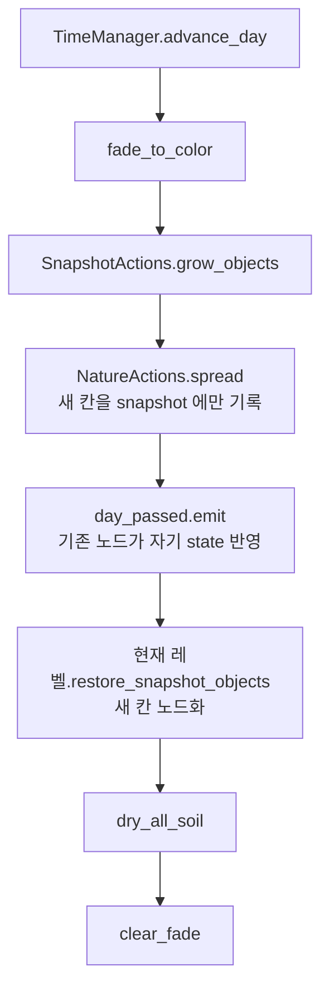

# 자연 확산 제안 (apo-farming 용)

참고: [nature_spread.md](nature_spread.md) (Stardew Valley 원본 정리)

## 0. 지금 구조에서 출발점

| 이미 있는 것 | 위치 | 확산에 쓰는 법 |
|---|---|---|
| 셀 → `{id, state}` 딕셔너리 | `GameState.farm_snapshot`, `SnapshotActions` | SV 의 `terrainFeatures`/`objects` 역할. 확산 판정을 **노드가 아니라 이 딕셔너리로** 한다 |
| 데이터만으로 성장 | `SnapshotActions.grow_objects()` → `CropObject.grow` / `TreeObject.grow` | 같은 자리에 `spread_objects()` 를 붙인다 |
| 스냅샷 → 노드 복원 | `BaseLevel.restore_snapshot_objects()` | 확산으로 생긴 칸은 이 함수로 그대로 노드화 |
| id 로 씬 생성 | `WorldObjectDB.create(id)` | 새 나무·풀은 id 만 넣으면 됨 |
| 흙 판정 | `TileUtils.TILLABLE_TERRAINS`, `CursorActions.layers_at` | SV 의 `Diggable` |
| 고정 지점 랜덤 스폰 | `NatureSpawner` (농장에 56개) | 초기 씨앗 역할만 남긴다 (5장) |

핵심 방침: **SV 처럼 "데이터 먼저 바꾸고, 노드는 복원 경로로 만든다".** 확산 로직이 노드를 직접 `add_child` 하면 복원 경로와 두 갈래가 생긴다.

## 1. 하루 넘김 순서



- `spread` 는 `grow_objects` **다음**. 오늘 다 자란 나무가 오늘 씨를 뿌릴 수 있게 한다 (SV 는 성장과 씨 뿌리기가 같은 함수 안에서 이 순서)
- `spread` 시작 시 대상 셀 목록을 **복사해 두고** 그것만 돈다. 오늘 생긴 칸은 오늘 다시 퍼지지 않음
- 화면이 검은 동안 노드가 생기므로 깜빡임이 없다
- 농장(`SnapshotActions.is_farm()`)일 때만 돈다. 지금 스냅샷이 농장 전용이라 그대로 따른다

## 2. 데이터 추가

### 2-1. `SpreadRule` 리소스 (신규)

```gdscript
class_name SpreadRule extends Resource

enum Mode { SEED_RADIUS, NEIGHBOR_4 }

@export var mode: Mode = Mode.SEED_RADIUS
@export_range(0.0, 1.0) var chance: float = 0.15
@export var radius: int = 3
@export var min_stage: int = -1
@export var max_density: int = 4
@export var spawn_id: StringName = &""
@export var spawn_state: Dictionary = {}
@export var blocked_by_neighbor_radius: int = 0
```

`WorldObjectData` 에 `@export var spread: SpreadRule` 하나만 추가한다. 비어 있으면 안 퍼진다.
`spawn_id` 가 비면 자기 id 를 쓴다. 나중에 "나무가 풀을 뿌린다" 같은 변형을 데이터만으로 만들 수 있다.

### 2-2. 리소스별 값

| tres | mode | chance | radius | 조건 | 생성 state |
|---|---|---|---|---|---|
| `oak_tree.tres` | SEED_RADIUS | 0.15 | 3 | `growth_stage >= max_growth_stage` | `growth_stage: 0` |
| `pine_tree.tres` | SEED_RADIUS | 0.10 | 3 | 〃 | 〃 |
| `grass.tres` | NEIGHBOR_4 | 0.25 (방향당) | 1 | `density >= 4` | `density: 1~2` |
| `rock.tres` | 없음 | | | | |

돌은 퍼지지 않는다. SV 에서 돌이 "번지는" 건 잡초·돌 디버리 시스템 얘기이고, 우리 돌은 채굴 자원이라 성격이 다르다.

### 2-3. 풀에 밀도 state 추가

SV 의 `numberOfWeeds` 0~4 를 그대로 가져온다. **가득 찬 칸만 퍼진다**는 규칙 하나로 확산 속도가 조절되는 게 핵심이라서다.

- `GrassObject.state` 에 `"density": 4` 추가 (씬에 놓인 풀·`NatureSpawner` 가 만든 풀은 4로 시작)
- 매일 `density += 1~3` (최대 4). `grow_objects` 의 분기에 `GrassObject.grow(state, data)` 추가
- 그림: 지금 `CLUMPS` 9개를 크기 순으로 묶어 density 1~4 에 대응
  - 1: 작은 덤불 (`Rect2(107,36,22,26)`, `Rect2(9,64,24,26)`)
  - 2~3: 중간
  - 4: 큰 덤불 (`Rect2(133,46,64,50)` 등)
- `variant` 는 지금처럼 처음 한 번 뽑고, density 가 오를 때 같은 크기 묶음 안에서만 다시 뽑는다

## 3. 확산 알고리즘

### 3-1. `NatureActions.spread()` (신규, `actions/nature_actions/`)

```gdscript
static func spread() -> void:
	if not SnapshotActions.is_farm():
		return
	var rng := RandomNumberGenerator.new()
	var sources := SnapshotActions.cells_with(SnapshotActions.OBJECT)
	sources.shuffle()
	for cell in sources:
		var slot := SnapshotActions.get_slot(cell, SnapshotActions.OBJECT)
		var data := WorldObjectDB.get_data(slot.get("id", &""))
		if data == null or data.spread == null or not _ready_to_spread(slot["state"], data):
			continue
		match data.spread.mode:
			SpreadRule.Mode.SEED_RADIUS:
				_seed_radius(cell, data, rng)
			SpreadRule.Mode.NEIGHBOR_4:
				_neighbor_4(cell, data, rng)


static func _seed_radius(cell: Vector2i, data: WorldObjectData, rng: RandomNumberGenerator) -> void:
	var rule := data.spread
	if rng.randf() >= rule.chance:
		return
	var r := rule.radius
	var target := cell + Vector2i(rng.randi_range(-r, r), rng.randi_range(-r, r))
	if is_spawnable(target):
		_write(target, rule, data)


static func _neighbor_4(cell: Vector2i, data: WorldObjectData, rng: RandomNumberGenerator) -> void:
	var rule := data.spread
	for dir in [Vector2i.LEFT, Vector2i.RIGHT, Vector2i.UP, Vector2i.DOWN]:
		if rng.randf() < rule.chance and is_spawnable(cell + dir):
			_write(cell + dir, rule, data)
```

- `sources.shuffle()`: 딕셔너리 순서에 따라 항상 같은 쪽이 먼저 칸을 차지하는 치우침 방지
- `_write` 는 `SnapshotActions.set_slot(target, OBJECT, {id, state})` 만 한다. 노드는 1장의 복원 단계에서 생긴다
- SV 의 "칸마다 65% 로 처리" 는 밀도 성장(`density += 1~3`)과 겹쳐서 체감 차이가 작아 뺐다. 너무 빠르면 `NEIGHBOR_4` 앞에 칸 단위 확률을 다시 넣는다

### 3-2. `is_spawnable(cell)` — 빈 칸 판정

모두 만족해야 한다.

1. snapshot 에 `OBJECT` 슬롯 없음 (오늘 생긴 칸 포함)
2. snapshot 에 `SOIL` 슬롯 없음 → 갈아 둔 밭은 침범하지 않음 (6장에서 선택)
3. `Back` 레이어만 있음 (`layers_at` 결과가 `[Back]` 하나) → 바닥재·건물·물 칸 제외
4. 지형이 `TILLABLE_TERRAINS` 안에 있음
5. 씬에 놓인 비-스냅샷 노드와 겹치지 않음: 건물(`CursorActions.building_at`), 울타리 등 `object` 그룹 노드
6. 플레이어 칸 아님 (자고 일어난 자리 = 침대 앞에 나무가 솟지 않게)
7. 맵 사용 영역(`Land` used rect) 안

`NoSpawn` 대응으로는 **TileSet custom data `no_spawn: bool`** 을 하나 추가하는 걸 제안한다. 집 앞마당·길처럼 흙인데도 자라면 곤란한 곳을 칠해서 막는다. 처음에는 3·4번만으로 충분할 수 있으니 필요해질 때 넣는다.

5번은 셀마다 그룹 전체를 도는 `object_in_cell` 을 쓰면 느리다. `spread` 시작할 때 `object` 그룹을 한 번 돌아 `occupied: Dictionary[Vector2i, bool]` 를 만들어 쓴다 (`restore_snapshot_objects` 와 같은 방식).

### 3-3. 밀도 제한 — 나무

SV 는 "3x3 안에 다 자란 나무가 있으면 마지막 단계로 못 자람" 으로 숲이 꽉 차지 않게 막는다.
우리는 `TreeObject.grow` 에서 마지막 단계 직전에 같은 검사를 한다.

- `blocked_by_neighbor_radius = 1` 이면 주변 8칸 snapshot 에 다 자란 나무가 있을 때 `growth_stage` 를 `max - 1` 에 묶어 둔다
- 결과: 숲 가장자리로만 퍼지고, 안쪽은 어린 나무 상태로 남음 → 베면 그 자리가 다시 자람

## 4. 농장 밖 / 비어 있는 땅에 새 씨앗

SV 의 `spawnWeeds` 처럼, 풀이 하나도 없는 곳에서도 가끔 시작점이 생겨야 확산이 멈추지 않는다.

- `NatureActions.seed_random(count)`: 맵 사용 영역에서 무작위 셀 `count` 번 시도, `is_spawnable` 이면 `grass` density 1~2
- 매일 2~5회 시도, 15% 확률. 비 오는 날 ×2 (날씨가 생기면)
- 매월 1일이나 시즌 시작에 크게 한 번(×10) 넣는 이벤트는 날짜 시스템이 월/계절을 가지면 추가

## 5. `NatureSpawner` 정리

지금 `NatureSpawner` 는 매일 자기 칸에 나무/풀/돌/빈칸 중 하나를 뽑는다. 확산이 들어오면 역할이 겹친다.

제안: **첫날 한 번만 스폰하는 초기 배치 마커**로 줄인다.

- `TimeManager.day_passed` 연결 제거
- `GameState.once("nature_seeded_%s")` 분기만 남김 → 첫 진입 때 1회 스폰
- 이후 그 칸이 비면 다시 채우는 건 확산과 `seed_random` 몫
- 지금 `_spawn_*` 가 `add_child` 를 직접 하는데, 스냅샷에 쓰고 복원 경로로 노드화하도록 바꾸면 1장 방침과 맞는다
- 돌만은 확산이 없으니 "빈칸이면 n일 뒤 돌 재생성" 이 필요하면 스포너에 남긴다 (`respawn_days` 같은 필드)

## 6. 정할 것

| 질문 | 선택지 | 제안 |
|---|---|---|
| 방치한 밭을 풀이 덮나 | 침범 안 함 / 물 안 준 밭만 / 다 | **물 안 준 지 n일 지난 밭만**. 아포칼립스 분위기에 맞는 페널티지만 처음엔 끄고 시작 |
| 오늘 퍼질 칸이 다른 칸과 겹치면 | 먼저 쓴 쪽 우선 | `shuffle` 후 먼저 쓴 쪽 우선 (SV 와 같음) |
| 겨울·계절 | 계절 시스템 생기면 | 겨울엔 `spread` 전체 스킵, 풀 density 성장 정지 |
| 결정론 | 매번 랜덤 / 날짜+셀 시드 | 일단 매번 랜덤. 멀티나 리플레이가 필요해지면 `hash(day, cell)` 시드 |
| 확산 상한 | 없음 / 맵 칸 수의 n% | 상한 없이 밀도 규칙으로 버티고, 플레이해 보고 결정 |

## 7. 작업 순서

1. `SpreadRule` + `WorldObjectData.spread` 추가, oak/pine/grass tres 값 채우기
2. `GrassObject` density state + `GrassObject.grow` + 밀도별 그림
3. `NatureActions.spread` / `is_spawnable` / `occupied` 캐시
4. `TimeManager.advance_day` 에 `spread` → `day_passed` → 레벨 `restore_snapshot_objects` 순서 넣기
5. `TreeObject.grow` 에 주변 나무 밀도 제한
6. `NatureSpawner` 를 1회 초기 배치로 축소
7. `seed_random`
8. (선택) TileSet `no_spawn` custom data, 방치 밭 침범

1~4까지만 해도 "자고 일어나면 숲과 풀이 번진다" 가 동작한다.
